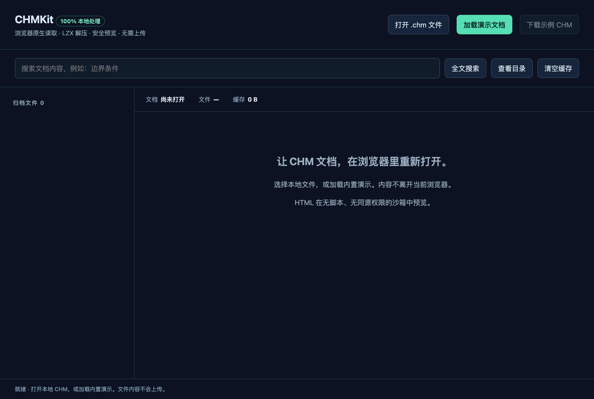
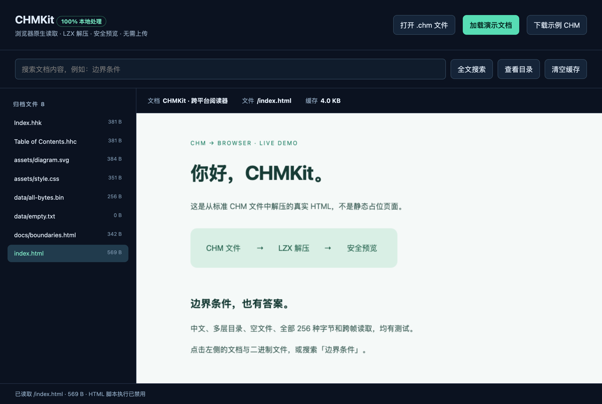
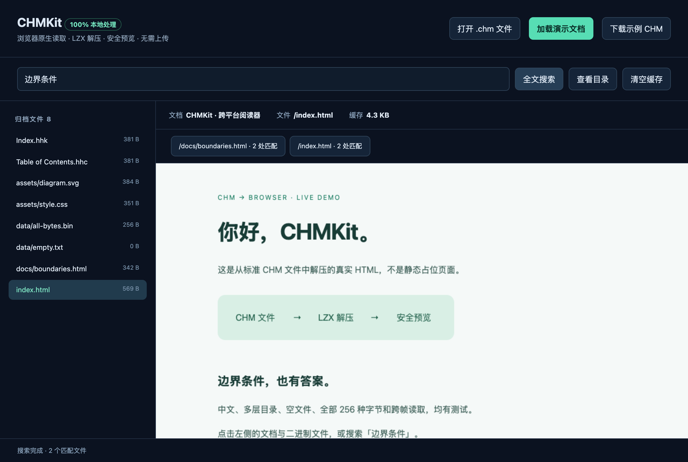
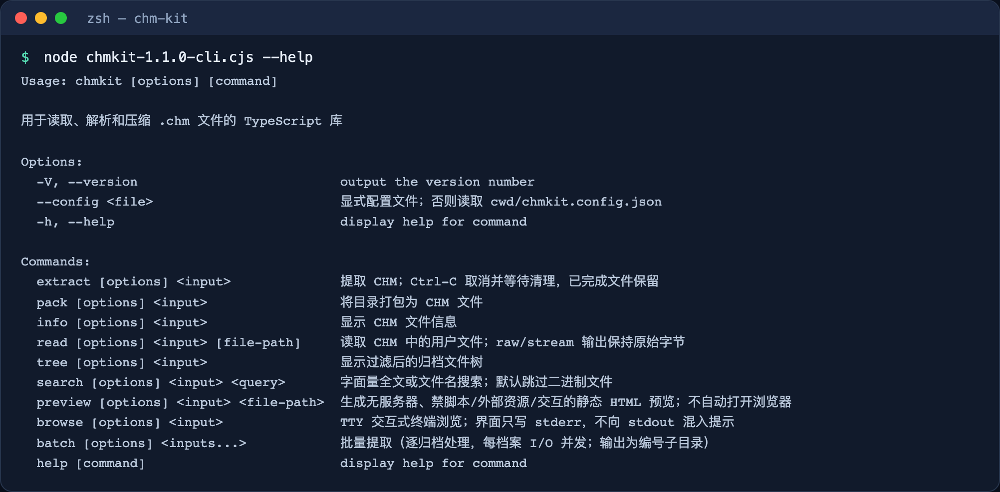
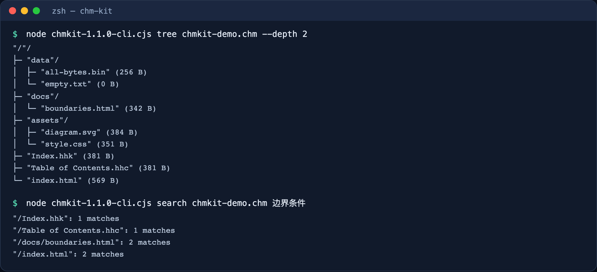
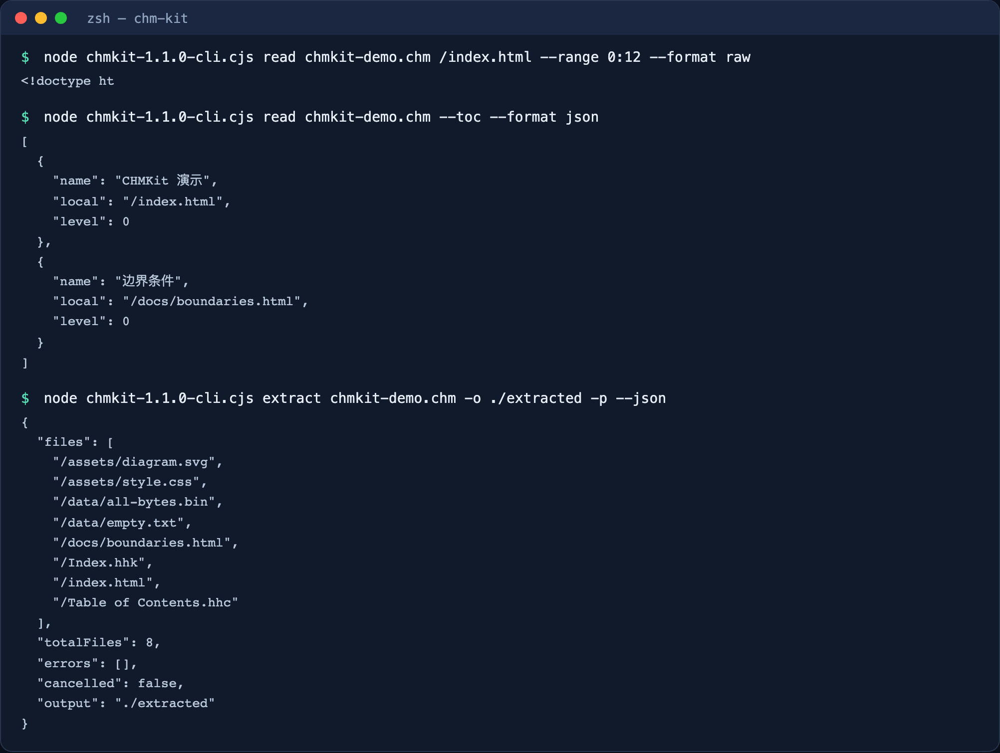

# CHMKit

Read, search, preview, extract and create Microsoft HTML Help (`.chm`) files in a
browser, a terminal, or a TypeScript application. Everything runs locally; **your
files are never uploaded**.

[中文](README.md) | **English** · [Documentation](docs/index.md) · [API reference](docs/api.md) · [Changelog](CHANGELOG.md)

## What it is

CHMKit has four entry points that share one parser and decompressor:

| Entry point                       | Use it for                                                                         | Requirements                                   |
| --------------------------------- | ---------------------------------------------------------------------------------- | ---------------------------------------------- |
| **Browser viewer**                | Double-click to open, pick a `.chm`, browse the contents, search and preview pages | A modern browser (Chromium / Firefox / WebKit) |
| **Command line `chmkit`**         | Inspect, list the file tree, search, read, extract, batch-extract and pack         | Node.js 20.10+                                 |
| **TypeScript library**            | Read, search and extract in Node.js services or web apps; create new CHM files     | Node.js 20.10+ or a modern browser             |
| **Worker / Electron integration** | Move parsing to a Worker, or expose archive capabilities safely in Electron        | The matching runtime                           |

Limits to know:

- CHMKit reads and writes CHM files. It is **not** a replacement for HTML Help Workshop.
- Compatibility is tested against independently sourced CHM files (PuTTY, 7-Zip,
  Inno Setup, PyCHM and the official FPC `fpdoc`), but no tool can guarantee every
  producer. Normal ITSF v2, GBK and UTF-16 real-world samples are still missing; see [TODO.md](TODO.md).
- Search is a literal scan of readable text resources. It does not read compiled search databases.
- The viewer's HTML preview is a restricted, script-free static preview, not a full browser.

## Video demos

**Usage tutorial (about 1 minute)**: the full browser viewer and command-line walkthrough.

<video src="media/chmkit-tutorial.mp4" controls preload="metadata" width="100%">
  <a href="media/chmkit-tutorial.mp4">Watch the usage tutorial</a>
</video>

**Promo (about 36 seconds)**: a feature overview.

<video src="media/chmkit-promo.mp4" controls preload="metadata" width="100%">
  <a href="media/chmkit-promo.mp4">Watch the promo</a>
</video>

Without background music: [usage tutorial](media/chmkit-tutorial-nobgm.mp4) · [promo](media/chmkit-promo-nobgm.mp4).

The interface and terminal output in the videos come from this repository's real build output. Captions are in Chinese. The video source and notes are in [media/](media/README.md).

## Get CHMKit

The npm package is **not published yet**. Choose one of the following.

### Option A: download the CI prebuilt bundle (no build)

1. Open [GitHub Actions](https://github.com/fwx5618177/chm-kit/actions) and pick the latest successful **CI** run on `main`.
2. Download the `chmkit-<commit>` artifact (requires GitHub sign-in; artifacts expire).
   `chmkit-api-<commit>` contains the generated TypeDoc API HTML.
3. The bundle contains:

| File                                                     | Purpose                                                            |
| -------------------------------------------------------- | ------------------------------------------------------------------ |
| `chmkit-<version>-browser.tar.gz`                        | Browser viewer (`dist/viewer/`) plus browser ESM modules and types |
| `chmkit-<version>-cli.cjs`                               | Standalone command-line tool; no `npm install` needed              |
| `chmkit-<version>.tgz`                                   | npm package with the library, installed CLI and type declarations  |
| `SHA256SUMS`, `manifest.json`, `THIRD_PARTY_NOTICES.txt` | Checksums, source metadata and third-party licenses                |

Verify the files before use:

```sh
shasum -a 256 -c SHA256SUMS      # on Linux: sha256sum -c SHA256SUMS
```

### Option B: build from source (contributors)

You need Node.js 22.13+ or 24 and pnpm 10.34.9 (as pinned in `package.json`).

```sh
git clone https://github.com/fwx5618177/chm-kit.git
cd chm-kit
pnpm install --frozen-lockfile --ignore-scripts
pnpm build                       # writes dist/cjs, dist/esm, dist/browser and dist/viewer
node dist/cjs/cli/index.js --help
```

To produce the npm tarball and standalone CLI, run `pnpm package:artifacts`; the outputs are in `dist/package/`.

## Quick start

### 1. Open a CHM in the browser

Extract the browser bundle and double-click **`dist/viewer/index.html`**. No Node.js,
npm, build step or local server is needed.

1. Click **「打开 .chm 文件」** (Open .chm file) to choose a local file, or **「加载演示文档」** (Load demo) for a built-in sample.
2. The left column lists archive files; click one to preview it. **「查看目录」** (View contents) shows the table of contents.
3. Type a keyword and click **「全文搜索」** (Full-text search); the results list matches per file.
4. **「下载示例 CHM」** (Download sample CHM) saves `chmkit-demo.chm`, which the command examples below use.







Loading the sample preview made no external network requests (verified in Chromium, Firefox and WebKit).

### 2. Use the command line

The examples use the standalone `chmkit-<version>-cli.cjs`. After installing the npm
package, you can run `chmkit` (or its alias `chm`) directly.

```sh
node chmkit-1.1.0-cli.cjs --help
```



| Command   | What it does                                                                                | Example                                                   |
| --------- | ------------------------------------------------------------------------------------------- | --------------------------------------------------------- |
| `info`    | Header details and statistics (`--json` for JSON)                                           | `chmkit info manual.chm`                                  |
| `tree`    | File tree with `--depth`, `--filter`, `--type`, `--json`                                    | `chmkit tree manual.chm --depth 2`                        |
| `search`  | Literal full-text search, or `--names` for filenames; skips binaries by default             | `chmkit search manual.chm "install" --json`               |
| `read`    | Read a file, `--list` files, `--toc` contents, `--index`; supports `--range` and `--stream` | `chmkit read manual.chm /index.html`                      |
| `extract` | Extract into a new directory; `-p` keeps the structure                                      | `chmkit extract manual.chm -o ./out -p`                   |
| `batch`   | Extract several CHM files into numbered subdirectories                                      | `chmkit batch a.chm b.chm -o ./out -p`                    |
| `preview` | Write a static HTML preview with no scripts or external resources                           | `chmkit preview manual.chm /index.html -o preview.html`   |
| `browse`  | Interactive terminal browsing (needs a TTY)                                                 | `chmkit browse manual.chm`                                |
| `pack`    | Pack a directory into a new CHM file                                                        | `chmkit pack ./site -o new.chm -t "Manual" -d index.html` |

Using the sample downloaded above:

```sh
node chmkit-1.1.0-cli.cjs tree chmkit-demo.chm --depth 2
node chmkit-1.1.0-cli.cjs search chmkit-demo.chm "边界条件"
```



```sh
node chmkit-1.1.0-cli.cjs read chmkit-demo.chm /index.html --range 0:12 --format raw
node chmkit-1.1.0-cli.cjs read chmkit-demo.chm --toc --format json
node chmkit-1.1.0-cli.cjs extract chmkit-demo.chm -o ./extracted -p --json
```



Conventions:

- Machine-readable output (`--json`, `--format raw`) goes to stdout; diagnostics and progress go to stderr.
- Exit codes: `0` success, `1` failure, `130` when `extract` is cancelled with Ctrl-C.
- `extract` and `batch` refuse to overwrite existing files and reject symlinked output directories. Use a new directory.
- `read --output` writes the file you name and **overwrites** an existing file.
- Confirm internal paths with `read <file> --list` or `tree`; do not assume `/index.html` exists.
- A `chmkit.config.json` in the current directory is loaded automatically; command-line flags take precedence. See [configuration and budgets](docs/guide/configuration.md).

Full reference: [CLI guide](docs/guide/cli.md) (in Chinese).

### 3. Read in Node.js

```ts
import { CHMReader } from 'chmkit';

const reader = await CHMReader.open('chmkit-demo.chm', {
  maxCacheBytes: 8 * 1024 * 1024,
  maxFileSize: 16 * 1024 * 1024,
});
try {
  console.log(reader.getMetadata(), reader.getTOC());
  const page = reader.listFiles('**/*.html')[0];
  if (page) {
    console.log(reader.readHTML(page));
    console.log(reader.readRange(page, 0, 12)); // Buffer for bytes [0, 12)
  }
  console.log(reader.search('边界条件', { maxResults: 10 }));
} finally {
  reader.close(); // releases caches and the file descriptor
}
```

- `CHMReader.open()` is asynchronous. After it opens, parsing and decompression are synchronous and block the event loop.
- The archive must not change until `close()`.
- For one-off operations, `CHMKit.readFile()`, `CHMKit.listFiles()` and `CHMKit.searchContent()` close their internal reader automatically.

### 4. Read in a browser application

```ts
import { CHMReader } from 'chmkit/browser';

// A File chosen with <input type="file"> is a Blob; nothing is uploaded.
const reader = await CHMReader.open(file, { maxFileSize: 16 * 1024 * 1024 });
try {
  console.log(reader.listFiles(), reader.getTOC());
  console.log(reader.readHTML('/index.html')); // text: do not insert it into the page DOM
} finally {
  reader.close();
}
```

- Browser input is a `Uint8Array`, `ArrayBuffer` or `Blob`, not a file path.
- Using the ESM modules directly requires serving `dist/browser/` over HTTP(S), keeping all files together.
- Never insert archive HTML into your DOM. The viewer uses a sandboxed iframe, a CSP and resource limits. See the [browser guide](docs/guide/browser.md) (in Chinese) and [examples/browser](examples/browser/README.md).

### 5. Create a new CHM

```ts
import { packFiles } from 'chmkit';
import { writeFile } from 'node:fs/promises';

const bytes = packFiles(
  new Map([['index.html', Buffer.from('<title>Manual</title><h1>Hello</h1>')]]),
  { title: 'Manual', defaultTopic: 'index.html', compressionLevel: 6 },
);
await writeFile('new.chm', bytes, { flag: 'wx' }); // wx: fail instead of overwriting
```

`packFiles()` returns new bytes. `updateArchive()` builds a new CHM from an existing archive; it does **not** edit the file in place.
See the [packing guide](docs/guide/packing.md).

### 6. Worker and Electron

- **Worker**: `chmkit/worker` provides a client and host with timeouts, cancellation and cleanup. See the [Worker guide](docs/guide/worker.md) and [examples/worker](examples/worker/README.md).
- **Electron**: `chmkit/electron/main` and `chmkit/electron/preload` expose only approved archive capabilities; the renderer cannot access the filesystem directly. See the [Electron guide](docs/guide/electron.md) and [examples/electron](examples/electron/README.md).

## Security and privacy

- All parsing is local. The viewer and CLI do not upload files.
- Extraction and preview reject path traversal, symlinks, unsafe output paths and inputs over their budgets.
- Previews use no scripts, a strict CSP and a sandbox. **A sandbox is not a network firewall.**
- When handling CHM files from unknown sources, set limits such as `maxFileSize` and consider running parsing in a separate process or Worker. Report vulnerabilities as described in [SECURITY.md](SECURITY.md).

## Compatibility and validation

- Supports ITSF v2/v3 structures and LZX VERBATIM, ALIGNED and stored blocks, including E8 translation and reset tables.
- Read results are checked against six independently sourced normal CHM archives (859 resource expectations) and the official FPC `fpdoc` archive.
- Test commands: `pnpm test` (Vitest), `pnpm exec playwright test` (Chromium, Firefox, WebKit and Electron), and `pnpm test:package` (consumer tests against the installed tgz).
- Recorded CI results and remaining gaps: [VALIDATION.md](VALIDATION.md).

## Documentation

The [documentation index](docs/index.md) lists every guide. The CLI, browser and
overall index guides are in Chinese; the Node, Worker, Electron, packing, configuration,
format and migration guides are in English.

## Contributing

See [CONTRIBUTING.md](CONTRIBUTING.md). Common commands:

```sh
pnpm typecheck && pnpm lint && pnpm format:check
pnpm test                     # Vitest (Node and native cases)
pnpm exec playwright test     # browser and Electron
pnpm test:package             # installed-tgz consumer tests (run pnpm package:artifacts first)
```

## License

CHMKit code is [MIT](LICENSE). Third-party test corpora keep their own licenses (including GPL/LGPL)
and are **not** included in the npm package or prebuilt downloads. See [licensing](docs/guide/licensing.md).
