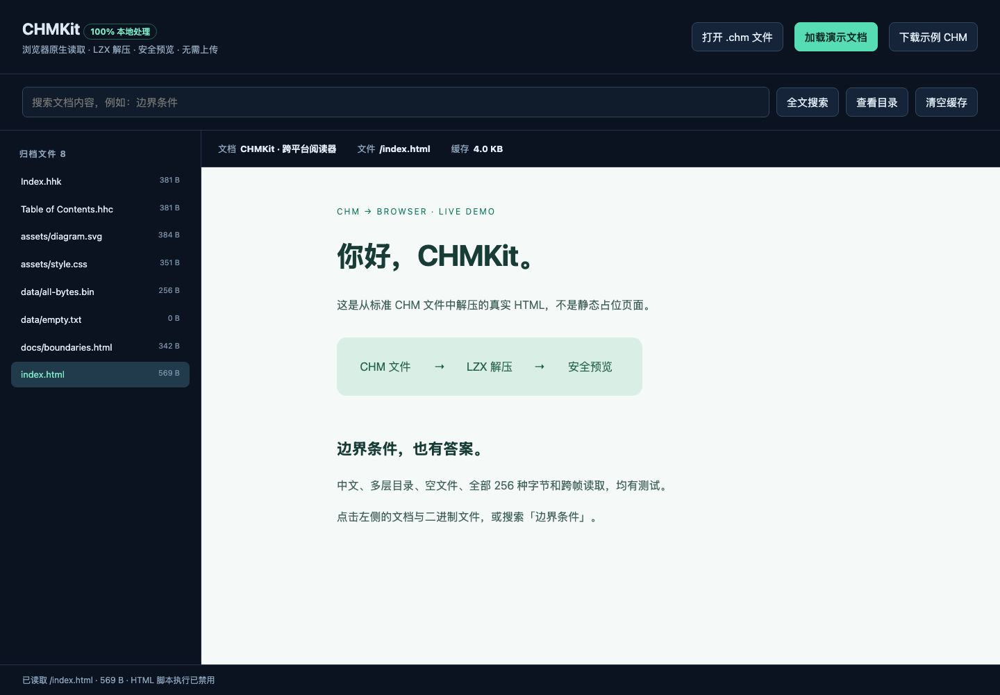

# CHMKit 工程化审计与当前验证记录

日期：2026-10-30。本记录为本轮提交前验收，提交与推送状态以 Git 历史和远端为准；本轮未发布 npm。此前的 459 项结果是上一轮记录，**当前结果如下**，不再使用旧的自定义执行器和报告。

## 当前实测结果

| 检查                                              | 结果                                                               |
| ------------------------------------------------- | ------------------------------------------------------------------ |
| `pnpm install --frozen-lockfile --ignore-scripts` | 锁文件一致，安装成功                                               |
| `pnpm typecheck`                                  | 源码、测试及测试配置全部通过                                       |
| `pnpm lint`                                       | 源码、测试及测试配置零错误、零警告                                 |
| `pnpm format:check`                               | 通过；不可变第三方 fixture 不参与格式化                            |
| `pnpm test`                                       | **530/530，33 个测试文件，0 失败、0 跳过**                         |
| Node project                                      | **506 项**源码单元/集成测试；包含真正执行并检查输出的日志测试      |
| Package project                                   | **24 项**构建参数、已安装 tarball、入口、CLI、声明及浏览器打包验收 |
| `pnpm test:browser`                               | **21/21**，Chromium/Firefox/WebKit 各 7 项；0 跳过、0 flaky        |
| Node 20.10.0 包验收                               | **24/24**；构建和实际隔离消费者运行均通过                          |
| `pnpm demo`                                       | 4 个源文件提取后逐字节一致；131,344 字节源内容生成 10,012 字节 CHM |
| `git diff --check`                                | 通过                                                               |

本机为 macOS / Darwin 24.6.0 arm64，默认 Node 24.15.0、pnpm 9.0.0。Vitest 3.2.7、Vite 5.4.21、Playwright Test 1.64.1；本轮三引擎为 Chromium 156.0.8078.4、Firefox 157.0、WebKit 27.2。外部 7-Zip 26.05 已安装，相关互通性用例没有跳过。

Node 20.10.0 验收会显示宿主 npm 11 自身的引擎警告，但测试成功；这不是 CHMKit 运行失败。开发工具版本与库运行时兼容性应分别验证，不能仅凭最新工具是否能在旧 Node 运行判断库兼容性。

## 本轮发现与处理

| 问题                                                     | 处理                                                                                          |
| -------------------------------------------------------- | --------------------------------------------------------------------------------------------- |
| uvu + 手写发现、子进程调度、解析 stdout 计数             | 迁移为原生 Vitest，删除旧执行脚本；没有兼容层                                                 |
| 手写浏览器启动、HTTP 服务、顺序依赖和成功报告            | 迁移为 Playwright Test；独立 page、三引擎项目、runner 管理 Vite 生命周期、原生报告/trace/截图 |
| 巨型包验收脚本和内联消费代码                             | 变为 Vitest package project、独立断言、可审阅消费源文件与临时配置矩阵                         |
| 消费者位于仓库下，可能继承祖先依赖                       | 移到系统真实临时目录；独立安装 tarball，无版本 overrides；干净 Node 子进程验证依赖解析        |
| Node 公开声明依赖 `@types/node` 却仅声明为 devDependency | 改为正式依赖，并验证实际安装与解析位置                                                        |
| 浏览器声明靠字符串删除 Node reference                    | 分离便携 reader/pack 类型和 Node 特化；删除输出修补，构建遇到泄露直接失败                     |
| 根入口在浏览器与 Node 的默认导出身份不同                 | 根入口统一为 CHMKit；显式 `chmkit/browser` 默认仍为 CHMReader                                 |
| 浏览器流返回 Buffer 子类                                 | 每块转普通 Uint8Array，保留背压、取消及逐帧状态；断言构造器、JSON 与 slice 语义               |
| 部分构建命令可静默接受错误参数，JS/声明可能混用          | 删除部分构建入口，只保留完整构建；非法/多余参数非零退出并有回归                               |
| 完整构建删除演示和测试报告                               | 只重建正式产物子目录，保留 demo 和证据                                                        |
| `ok(() => {...})` 日志断言不执行被测函数                 | 16 个用例保留，改为实际调用并验证 console、级别、时间戳、参数及前缀                           |
| Packer 门面丢弃两个验证选项及显式空元数据                | 正确转发并新增行为测试                                                                        |
| 旧公开通用 Huffman 接受无效树                            | 校验码长、过订阅、前缀、符号及码值边界，覆盖 32-bit 码                                        |
| 旧 LZX 专用 helper 使用伪模型                            | 明确弃用并显式拒绝，指向真正 LZXDecoder；不再返回假结果                                       |
| TOCBuilder 丢失没有父项的深层 HTML                       | 保留为根项，并修复目录前缀误匹配                                                              |
| 未接入/重复资产                                          | 删除闲置 BinaryDataReader/barrel、未接入的手工 sample-chm 和空配置示例                        |

### 保留不是妥协

- `test/fixtures/pychm-example/` 是不可变的真实 CHM 与 **独立 7-Zip 提取的 14 个资源**，有来源、SHA-256、清单和 GPL 通知。删除它会失去发现“本库读写同时犯同一种错”的能力。
- 合成字节、独立 ENCINT/PMGL 检查和 LZX 位流构造属于测试支持，不是生产 fallback；不能为了去重而改成全部调用被测实现。
- `src/encoder/archive-validation.ts` 是生产写入流程的本库读回校验，不是第三方 oracle。
- `src/browser-buffer.ts` 是构建期显式注入的内部 Buffer 适配，不安装全局 Buffer；内部解析实现仍使用 buffer 包。浏览器公开类型和值是原生 Uint8Array。
- 正式发布包的内容白名单与 tarball 测试确保 **test、fixtures、消费工程、报告和 demo 不进入 npm**。

## 唯一入口和配置职责

| 命令                                   | 职责                                                         |
| -------------------------------------- | ------------------------------------------------------------ |
| `pnpm test`                            | Vitest 一次性执行 Node + package 两项目                      |
| `pnpm test:unit`                       | 仅源码 Node 测试，无预构建要求                               |
| `pnpm test:watch`                      | Vitest 原生源码监听；CLI 测试启动当前 TS 源码，不使用旧 dist |
| `pnpm test:package`                    | 包验收，globalSetup 构建一次                                 |
| `pnpm test:browser`                    | 三引擎 UI/浏览器验收，globalSetup 构建一次                   |
| `pnpm test:browser --project=chromium` | 选择一个引擎，不另建配置                                     |
| `pnpm test:all`                        | Node + 包验收 + 三引擎验收                                   |
| `pnpm build`                           | 完整 Node CJS/ESM、CLI、browser、声明构建                    |
| `pnpm demo`                            | 生成可比较的 CHM、提取内容和演示报告                         |

只有一份 `vitest.config.mts` 和一份 `playwright.config.ts`。前者负责 Node/消费包项目；后者负责真实浏览器自动化，不能用 jsdom 或 Node 测试冒充。`tsconfig.json` 负责源码声明，`tsconfig.test.json` 负责测试和配置的 no-emit 检查，职责不同。四种消费类型场景使用测试矩阵，在临时消费者内生成配置，不再保留五份消费 tsconfig。

`scripts/` 只保留 `build.mjs` 和 `demo.mjs` 两个有明确命令入口的工程工作流；所有测试都由标准 runner 发现和报告。

## 证据与重跑

- `test-results/vitest.json`：Vitest 原生结果，包含 530 项。
- `test-results/package-node20.json`：Node 20.10.0 的 24 项独立包验收。
- `test-results/browser/results.json`：Playwright 原生三引擎结果与版本注解。
- `test-results/browser/html/`：HTML 报告；`artifacts/` 内有截图与测试附件，失败时保留 trace。
- `dist/demo/{sample.chm,input,extracted,report.json,info.json,toc.json,search.json}`：实际数据演示。

```sh
pnpm install --frozen-lockfile --ignore-scripts
pnpm exec playwright install chromium firefox webkit
pnpm typecheck
pnpm lint
pnpm format:check
pnpm test:all
pnpm demo
```

最低运行时验收（单独输出，避免覆盖完整报告）：

```sh
pnpm dlx node@20.10.0 node_modules/vitest/vitest.mjs run --project package --outputFile.json=test-results/package-node20.json
```

浏览器安装会联网；隔离消费包安装允许访问 registry。两者都不是发布操作。可设置 `CHM_7Z` 指定外部 oracle，`CHM_REQUIRE_7Z=1` 强制工具缺失时报错。

### 实际预览



手动启动静态服务器后访问 http://127.0.0.1:8080/examples/browser/，点击“加载演示文档”或打开 `dist/demo/sample.chm`：

```sh
python3 -m http.server 8080 --bind 127.0.0.1
```

服务器供手动本地使用，Ctrl+C 停止。自动化验收不依赖手动启动它。

## 行为变化和未验证事项

- 旧部分构建命令已删除，调用者应使用 `pnpm build`；旧测试脚本改为上述正式 runner 命令。
- `Huffman.createLZXDecoder/readCodeLengths/buildPredefinedTree` 等旧伪 LZX helper 现在明确弃用/抛错，不保留看似成功的伪实现。真正的 CHM/LZXDecoder 解码不受影响。
- 输入归档仍完整载入内存；普通随机范围可能解码整个相关 reset 组，顺序范围流则逐帧复用。目录展开及单次输出有安全限制。
- **Windows/Linux 托管 CI 尚未实际执行**；矩阵与报告上传已接入新命令，但配置不是通过证据。
- 更多真实 CHM 语料、自适应压缩、文件系统随机读取、Electron IPC 等仍见 [TODO.md](TODO.md)。测试通过不代表穷尽全部输入、最优压缩或所有生产工具兼容。
