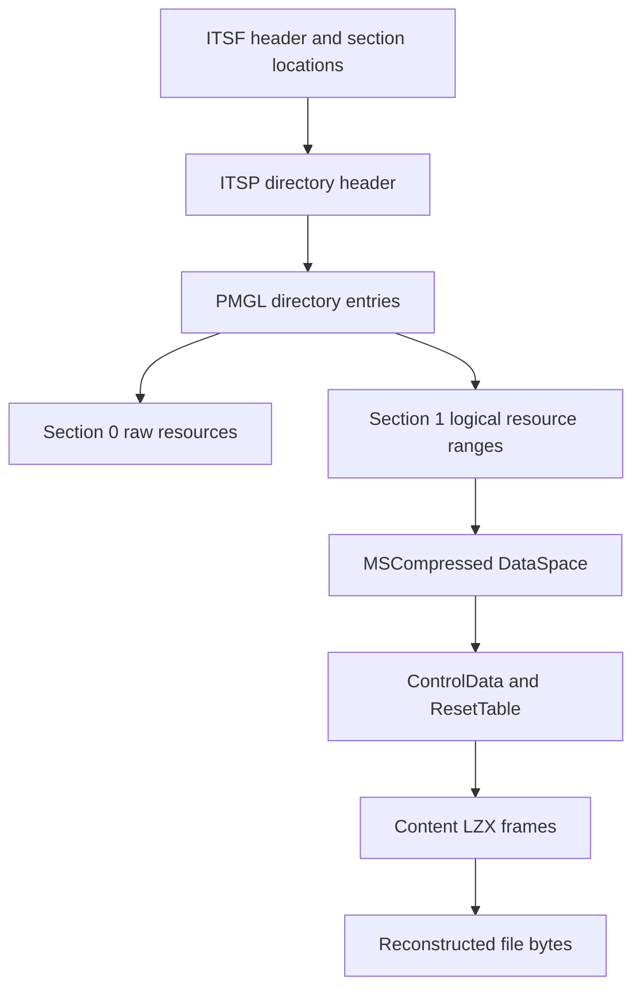

# Understanding CHM and LZX

[Documentation](../index.md) · [Packing](packing.md) · [Resource budgets](configuration.md)

This guide explains the implementation model and practical tradeoffs. It is not
a complete binary format specification or a promise to support every producer's
extension. Consult exported types and the relevant parsers when inspecting fields.

## Container layers

- **ITSF:** identifies the container/version and the actual directory/data bases.
  ITSF v2 and v3 have different header layouts. An auxiliary header section is
  not automatically the resource data base.
- **ITSP / PMGL:** directory metadata and resource names/section/offset/length.
  Encoded integers and offsets must fit safe arithmetic and actual source bounds.
  Large directories can contain multiple PMGL chunks and PMGI indexing structures.
- **Section 0:** resource offsets address uncompressed container storage using
  the explicit data base.
- **Section 1:** resource offsets are logical offsets in a shared decompressed
  stream, not physical byte offsets into the file.
- **DataSpace:** `::DataSpace/.../MSCompressed/` contains the compressed Content,
  LZXC ControlData, SpanInfo and ResetTable transport description.
- **`#SYSTEM`, `.hhc`, `.hhk`:** runtime metadata, TOC and keyword navigation.
  Compiled topic/search/window structures are separate and are not universally
  interpreted or regenerated by this library.

Do not infer that compressed content must follow the directory. Real archives
can put the directory at EOF and use an explicit data base of **zero**. Zero is
not a universal instruction to substitute `directoryEnd`. Bounds and per-resource
validation remain necessary regardless of physical ordering.

## Frame, block, window and reset are different things

| Term      | Meaning                                       | User-visible implication                          |
| --------- | --------------------------------------------- | ------------------------------------------------- |
| Frame     | CHM physical decompression unit, 32768 bytes  | Changing block size does not change it            |
| LZX block | Stored, VERBATIM or ALIGNED coded region      | Encoder can choose smaller blocks within frames   |
| Window    | Sliding dictionary of prior bytes             | Larger dictionary increases decoder workspace     |
| Reset     | Boundary resetting decoder history/tree state | Random access may decode from its preceding reset |
| Resource  | Directory entry selecting a logical range     | Multiple files can share frames and history       |

LZX bit coding is MSB-first within little-endian 16-bit words. Huffman trees,
match offsets, repeated offsets, block alignment and dictionary history are part
of the format; reading a few guessed fixed bits is not LZX decompression.

The decoder implements VERBATIM, ALIGNED and stored blocks, cross-frame/reset
state, sliding-window matches and Intel E8 decoding. The writer emits genuine
LZX and chooses among fixed/adaptive canonical Huffman candidates, ALIGNED
candidates at higher levels and stored fallback. It does not emit Intel E8
preprocessing merely because the decoder supports E8. Unsupported/corrupt states
must produce errors, not guessed output.

`compression: false` bypasses LZX for user resources. `compressionLevel: 0` with
compression enabled instead retains the LZX transport and stored blocks.
A stored block still participates in dictionary/offset state.

## Why a small range can need more decoding

To read a resource interval starting inside a compressed stream, the decoder may
need to reconstruct earlier bytes from the nearest preceding reset. That prefix
is necessary history, not part of the caller's returned range. Large reset groups
can therefore make cold random reads expensive even when output is small.

`readRange()` materializes only requested output. A sequential
`createReadStream()` reuses frame-by-frame decoder state instead of repeatedly
calling independent ranges. Its working state is the dictionary, physical frame
and output chunk rather than a whole reset group's decoded bytes. Source input,
metadata, optional caches and retained caller output are separate costs.

Streams provide output backpressure, **not asynchronous decoder CPU**. Node
file-backed source reads and decoder work remain synchronous on the calling thread.
`maxCacheBytes` is not a complete process-memory budget, and a tiny requested
range does not imply tiny CPU time. See [configuration](configuration.md).

## Honest compression statistics

A file inside a shared LZX stream has a logical uncompressed size but generally
no independently attributable physical compressed size. CHMKit reports `null`
for that per-file compressed size/ratio rather than fabricating a proportional
estimate. Whole-stream/container statistics are a different measurement.

The writer pads physical frames as required by the CHM transport. Logical file
lengths exclude padding. Directory/metadata overhead means a tiny archive can
be larger than its input even when its content uses compression.

## Compatibility evidence and remaining limits

Independent upstream corpora cover actual HHA/Halibut archives, VERBATIM/ALIGNED
content, multi-frame/multi-reset data and different real windows/layouts.
Byte expectations come from independent 7-Zip extraction, not CHMKit self-roundtrip.
See [fixture provenance](../../test/fixtures/upstream-chm/README.md).

That evidence does not establish universal producer compatibility. Check the
fixture manifests and [validation record](../../VALIDATION.md) for the layouts,
encodings, windows and reset combinations actually exercised. Malformed samples
and synthetic/header-modified tests do not substitute for normal independently
sourced archives. Implementation support and real-corpus coverage are distinct.

Bounded mutation tests exercise specific corruptions with process/input/output
deadlines. A parser rejecting early may not reach a later mutated field. Agreement
between two decoders on selected samples is useful evidence, not exhaustive fuzz
coverage or a proof that all hostile inputs are safe. Current commands/results
belong in [VALIDATION.md](../../VALIDATION.md).

## Code map for contributors

- `src/core/headers/`, `src/core/directory/`, `src/core/parser/`: structural parsing.
- `src/core/lzx/`: decoder, bit reader, reset table and sliding window.
- `src/core/files/`: source abstraction and file/range reconstruction.
- `src/reader/`: cache/budget/lifetime API and Node file source.
- `src/encoder/`: canonical trees, match finding, archive serialization/navigation.

Legacy pseudo-LZX Huffman helper methods intentionally throw unsupported errors;
use `LZXDecoder` for actual decoding. See [migration](migration.md).
