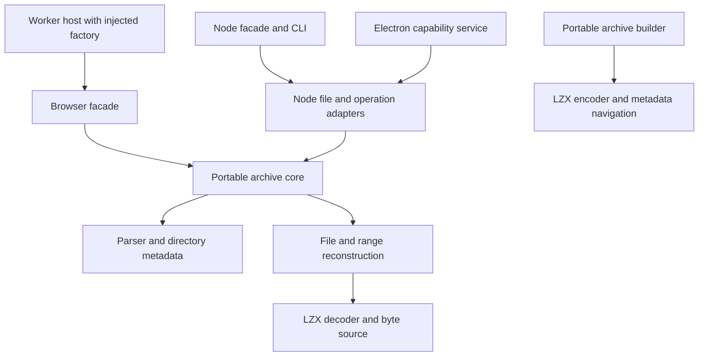

# Source architecture for contributors

[Documentation](../index.md) · [API](../api.md) · [Contributing](../../CONTRIBUTING.md)

Consumers use compiled downloads. This map is for changing CHMKit without breaking
runtime boundaries or public behavior; it is not an extra source-build requirement.

## Data reading

`src/core/headers/` parses ITSF/ITSP/LZXC and safe binary fields.
`src/core/directory/` handles PMGL entries and encoded integers;
`src/core/parser/` combines validated structures. Physical content base must come
from the format, not a guessed ordering of header/directory/content sections.

`src/core/files/byte-source.ts` makes positioned input independent of memory/file
storage. `file-reconstructor.ts` turns logical resource ranges into output using
reset history and sequential decoder state. `src/core/lzx/` owns actual bit/tree/
match/frame/reset semantics. Do not duplicate those semantics in CLI/stream loops.

`src/reader/chm-archive.ts` provides portable discovery, reads, navigation, search
and managed cache budgeting. The Node reader/file source owns fd acquisition,
positioned synchronous reads and a bounded sequential source window. Its
`readAhead` setting is separate from the archive core's default-off
`adaptivePreload` adjacent-file timer queue. Prediction remains same-thread
synchronous input/decode inside callbacks; failures close the archive and remain
observable through `getPreloadError()`. Cache clearing/disable/close must cancel
queued work. The browser facade converts public results to ordinary Uint8Array
without exposing Node Buffer types.

`src/operations/extractor.ts` also owns file-backed positioned input rather than
reading the complete archive. Independent output generators retain decoder state
and write bounded chunks asynchronously; they are not multicore CPU workers.
Reader/extractor input must stay immutable for the descriptor lifetime, including
cache hits. Descriptor metadata validation is not file locking.

## Data writing

`src/encoder/archive-builder.ts` normalizes portable paths, builds navigation and
`#SYSTEM`, serializes transport and handles supported rebuild updates.
`lzx-encoder.ts` and `canonical-huffman.ts` implement bounded match finding,
length-limited trees and cost-based block selection. `navigation.ts` handles
folder/explicit TOCs, trusted `tocTemplate` wrappers and URL target validation.
`packTemplate` is a separate whole-file Map overlay with byte replacement/addition
and explicit null deletion, not a string interpolation engine.

Filesystem scanning/writing belongs in `CHMEncoder` and Node operations rather
than pure `packFiles`. Updating is a deliberate restricted reconstruction path,
not a generic rewrite of compiled topic/search data. Preserve refusal cases when
adding support; do not make unsupported structures silently disappear.

## Runtime adapters

- `src/cli/`: Commander command shapes, clean machine output, filters,
  config-to-action wiring, static preview, interactive browse and batch extraction.
- `src/worker/`: protocol validation, request correlation, per-archive sequencing,
  bounded payloads, ownership and cleanup; reader factories are explicit.
- `src/electron/`: frame/sender-scoped approved capabilities and separate preload
  plain-function bridge. Main factories choose files; renderer input does not.
- `src/browser-resources.ts`: raw/URL path resolution and bounded DOM preview
  resource rewriting. It does not belong in the portable parser or a plain Worker
  without DOM. Sandbox/CSP are required independent boundaries.
- `src/core/config.ts`: validated data loading/merging/caching. CLI runtime lists
  actual connected fields; config acceptance alone is not operation behavior.

## Build and evidence

`scripts/build.mjs` owns complete public JS/declaration generation. Public entry
changes must update package metadata and isolated consumer tests along with the
build. Node/browser declaration types must be correct at source level, not patched
in generated files. Preserve browser chunks and do not install Electron to satisfy
an accidentally leaked nominal type.

`scripts/package.mjs` produces and verifies consumer assets from allowlisted public
outputs. `scripts/release.mjs` verifies approval/source/asset identity for manual
draft releases; `.github/PIPELINES.md` documents that policy. Source/demo/test
fixtures are not deliverable runtime assets.

Use Node 22.13+ or 24 and pnpm 10.34.9 for development. CI installs dependencies
on Node 24 before switching to runtime targets, including Node 20.19; that older
runtime is not the dev-tool installation floor. ESLint 10 uses the flat
`eslint.config.mjs`. Node/package/delivery acceptance uses Vitest 4.1.12 with
Vite 7.3.7; real-browser acceptance uses Playwright. `test/delivery/*.test.mjs`
are native Vitest tests included by default `pnpm test`, with
`pnpm test:delivery` for focused runs. Do not restore the removed Node test runner.
Independent fixture oracles and bounded mutation/differential tests must not be
replaced with self-generated expected output. `pnpm test:bench` runs native
Vitest benchmarks once; memory workloads use fresh processes.

`pnpm docs:build` uses TypeDoc 0.28.20 / `typedoc.json` to generate `dist/api/`
with warnings as errors. CI uploads HTML separately as `chmkit-api-<source-sha>`;
consumers can browse it without building. Keep source guides in `docs/`, not
generated HTML, and do not infer public hosting from artifact generation.
See [contributing](../../CONTRIBUTING.md) for commands, [licensing](licensing.md)
for corpus rules, and [VALIDATION.md](../../VALIDATION.md) for actual execution.
